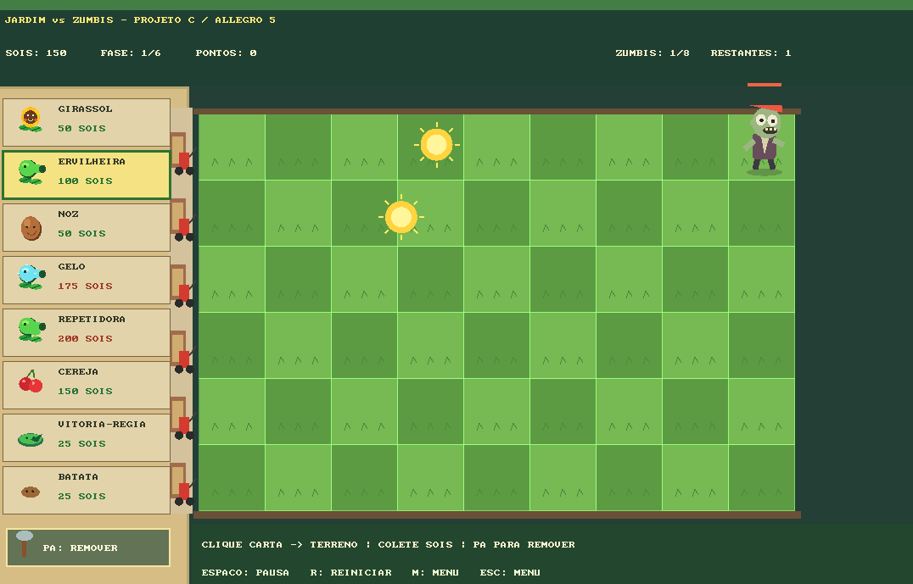

# 🌻 Plants vs. Zombies em C — Allegro 5

Recriação educacional e não oficial, inspirada no jogo **Plants vs. Zombies**, desenvolvida em linguagem C utilizando a biblioteca Allegro 5.

O objetivo é proteger o jardim contra ondas de zumbis, utilizando diferentes plantas e estratégias de defesa.


## 📸 Captura de tela




## Funcionalidades

- 6 fases com dificuldade progressiva.
- 8 tipos de plantas.
- 12 variedades de zumbis.
- Fase da piscina a partir do nível 4.
- Sistema de coleta de sóis.
- Pá para remover plantas.
- Efeitos sonoros, menu e telas de vitória e derrota.

## Tecnologias

- Linguagem C
- Allegro 5
- GCC
- MSYS2 UCRT64

## Como executar

Compile o código:

```bash
gcc plants_vs_zombies.c -o plants_vs_zombies.exe -lallegro -lallegro_primitives -lallegro_font -lallegro_audio -lallegro_acodec -lm
```

Execute:

```bash
./plants_vs_zombies.exe
```

## Objetivo

Projeto acadêmico desenvolvido para praticar programação em C, estruturas de dados, eventos, colisões, interface gráfica e desenvolvimento de jogos 2D.

## Aviso

Projeto educacional, não oficial e sem fins comerciais. Plants vs. Zombies pertence aos seus respectivos titulares. Os desenhos e efeitos sonoros incluídos são criações próprias para esta implementação.